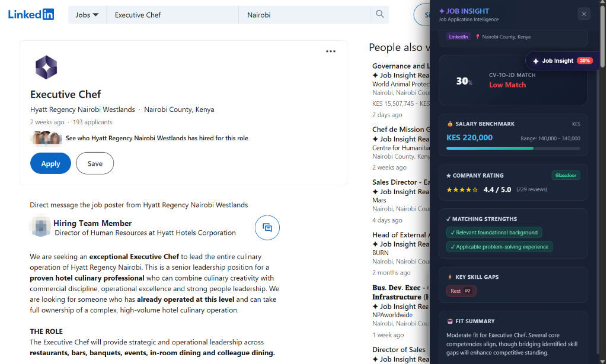
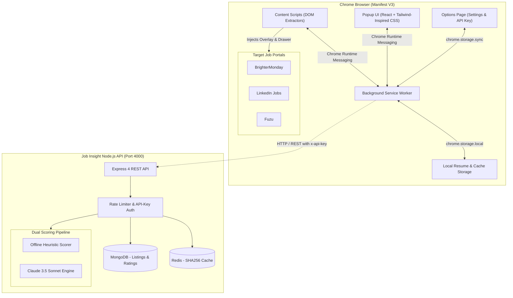

# ✦ Job Insight Extension

<p align="center">
  <strong>Next-Gen Job Application Intelligence Overlay for BrighterMonday, LinkedIn, and Fuzu</strong>
</p>

<p align="center">
  
  
  
  
  
  
  <a href="https://crnjihia.github.io/job-insight-extension/"></a>
  
</p>

---

<p align="center">
  
</p>

---

## 📌 Overview

**Job Insight Extension** is a developer and professional companion Chrome extension designed to eliminate guesswork from your job search. 

When you browse job vacancies on **LinkedIn**, **BrighterMonday**, or **Fuzu**, Job Insight automatically injects an intelligent glassmorphism badge and slide-out drawer that provides:

1. 🎯 **AI-Powered Match Score (0–100%)**: Evaluates how well your resume matches the job description.
2. 🚀 **Strengths & Skill Gap Identification**: Highlights skills you possess and marks missing requirements.
3. 💰 **Regional Salary Benchmarking**: Displays estimated compensation bands (minimum, median, maximum) localized to East Africa (KES) or global currencies.
4. 🏢 **Glassdoor-Style Company Intelligence**: Aggregates verified employer ratings and review volumes.
5. 📄 **Instant PDF Resume Parser**: Extracts text client-side or server-side with local offline caching.

---

## ⚡ Dual-Mode Intelligence Engine

Job Insight Extension works right out of the box with zero external configuration, and can seamlessly scale up to Claude 3.5 Sonnet:

| Engine | Setup | Cost | Description |
|---|---|---|---|
| **Intelligent Heuristic Engine** *(Default)* | Zero configuration (`CLAUDE_API_KEY` left empty) | **100% Free** | Instant local parsing, heuristic keyword and seniority weight matching, regional benchmark lookup, and employer scoring. Perfect for local dev and offline use. |
| **Claude 3.5 Sonnet Engine** *(Optional)* | Add Anthropic API Key in `backend/.env` | Pay-as-you-go | Performs deep semantic LLM reasoning, subtle qualification analysis, tone evaluation, and tailored cover-letter style recommendations. |

---

## 🏗️ Architecture



---

## 🚀 Quick Start Guide

### 1. Prerequisites
- **Node.js** v20.x or later ([Download](https://nodejs.org/))
- **Google Chrome** (or Chromium-based browser: Brave, Edge, Arc)
- *(Optional)* Docker and Docker Compose

### 2. Clone the Repository
```bash
git clone https://github.com/crnjihia/job-insight-extension.git
cd job-insight-extension
```

### 3. Install All Dependencies
```bash
npm install
```

### 4. Configure Backend Environment
Copy the example environment configuration into `backend/.env`:
```bash
cp backend/.env.example backend/.env
```
*(The default configuration already has offline heuristic scoring enabled and database fallbacks in place—no keys required to start!)*

### 5. Start the Backend Server
```bash
npm --prefix backend run build
npm --prefix backend start
```
The API is now live at **`http://localhost:4000`** with a health endpoint at `http://localhost:4000/health`.

### 6. Build and Load the Chrome Extension
1. Build the production extension bundle:
   ```bash
   npm run build:extension
   ```
2. Open Google Chrome and navigate to:
   ```text
   chrome://extensions/
   ```
3. In the top-right corner, toggle on **Developer mode**.
4. Click **Load unpacked** (top-left) and select the directory:
   ```text
   <path-to-repo>/extension/dist
   ```
5. Pin **Job Insight Extension** in your Chrome toolbar!

---

## 🧪 How to Test the Application

### Step 1: Upload Your Resume
1. Click the **Job Insight** icon in your browser toolbar to open the extension popup.
2. Select the **"My Resume"** tab.
3. Upload any PDF resume, or paste plain CV text into the manual editor and click **"Save Resume"**.
4. The extension saves your CV locally in encrypted `chrome.storage.local`.

### Step 2: Test on Job Boards
Navigate to any live vacancy on:
- **LinkedIn Jobs**: [linkedin.com/jobs](https://www.linkedin.com/jobs) (open any job post)
- **BrighterMonday**: [brightermonday.co.ke](https://www.brightermonday.co.ke) (open any vacancy)
- **Fuzu**: [fuzu.com/kenya](https://www.fuzu.com/kenya) (view any listing)

### Step 3: Trigger the Analysis Overlay
1. Click the floating **`✦ Job Insight`** badge on the page.
2. The dark-mode slide-out drawer will appear:
   - **Radial Match Dial**: Instant score (e.g., `85% Match`).
   - **Key Strengths**: Matching skills highlighted in emerald green.
   - **Missing Qualifications**: Identified skill gaps with priority tags.
   - **Salary Benchmark Widget**: Min, median, and max compensation in KES.
   - **Company Glassdoor Score**: Verified employer ratings and review count.

### Offline Testing with Included HTML Fixtures
If you don't have active internet access to job boards, open the bundled fixtures directly in Chrome (`Ctrl + O`):
- [tests/fixtures/linkedin-job.html](tests/fixtures/linkedin-job.html)
- [tests/fixtures/brightermonday-job.html](tests/fixtures/brightermonday-job.html)
- [tests/fixtures/fuzu-job.html](tests/fixtures/fuzu-job.html)

---

## 📡 REST API Reference

The backend provides authenticated REST endpoints on `http://localhost:4000` (secured with header `x-api-key: job-insight-secret-key-2024`):

| Endpoint | Method | Description | Sample Request |
|---|---|---|---|
| `/` | `GET` | Service verification | `curl http://localhost:4000/` |
| `/health` | `GET` | Health check probe | `curl http://localhost:4000/health` |
| `/analyze` | `POST` | CV vs. JD match analysis | JSON with `jobTitle`, `company`, `location`, `jobDescription`, `cvText` |
| `/company/:name` | `GET` | Company Glassdoor lookup | `curl -H "x-api-key: ..." http://localhost:4000/company/Safaricom` |
| `/salary` | `GET` | Title salary benchmark | `curl -H "x-api-key: ..." "http://localhost:4000/salary?title=Software%20Engineer"` |
| `/cv/upload` | `POST` | Multipart PDF text extraction | `curl -F "cv=@resume.pdf" http://localhost:4000/cv/upload` |

#### Sample `/analyze` Response
```json
{
  "matchScore": 88,
  "skillGaps": [
    { "skill": "Kubernetes orchestration", "importance": 4 }
  ],
  "strengths": [
    "TypeScript",
    "React",
    "Node.js",
    "Docker"
  ],
  "summary": "Strong candidate fit. Possesses core technical stack with minor gaps in container orchestration.",
  "salaryBenchmark": {
    "min": 180000,
    "median": 260000,
    "max": 380000,
    "currency": "KES"
  },
  "companyRating": {
    "rating": 4.4,
    "reviews": 312,
    "source": "Glassdoor"
  }
}
```

---

## 🛠️ Monorepo Scripts Cheat Sheet

| Command | Description |
|---|---|
| `npm run build` | Builds both extension (`extension/dist`) and backend (`backend/dist`) |
| `npm run build:extension` | Compiles extension with Vite |
| `npm run build:backend` | Compiles backend with TypeScript (`tsc`) |
| `npm test` | Runs the full Vitest suite (DOM extractors + backend routes) |
| `npm run package` | Packages extension into production `job-insight-extension-v0.1.0.zip` |
| `docker-compose up -d` | Launches MongoDB, Redis, and Backend API in isolated containers |

---

## 🐳 Docker Deployment

To spin up the entire backend stack with MongoDB and Redis caching:

```bash
docker-compose up --build -d
```

To stop containers:
```bash
docker-compose down
```

---

## 🔒 Security & Chrome Web Store Compliance

Job Insight Extension was engineered in full compliance with **Chrome Web Store Review Policies**:
- **Manifest V3 Only**: Zero usage of deprecated MV2 features or remote script execution.
- **Minimal Permissions Principle**:
  - `storage`: For storing user preferences and cached CV text locally.
  - `activeTab` & `scripting`: For interacting with user-initiated job listings.
- **Narrow Host Permissions**: Strictly restricted to `*.linkedin.com`, `*.brightermonday.co.ke`, and `*.fuzu.com`.
- **Transparent Data Privacy**: No analytics trackers, no selling of user data. See our full [Privacy Policy](privacy-policy.md).

---

## 🤝 Contributing

Contributions, bug reports, and suggestions are welcome! Please read [CONTRIBUTING.md](CONTRIBUTING.md) for full development guidelines, coding standards, and PR templates.

---

## 📄 License

This project is licensed under the [MIT License](LICENSE).
